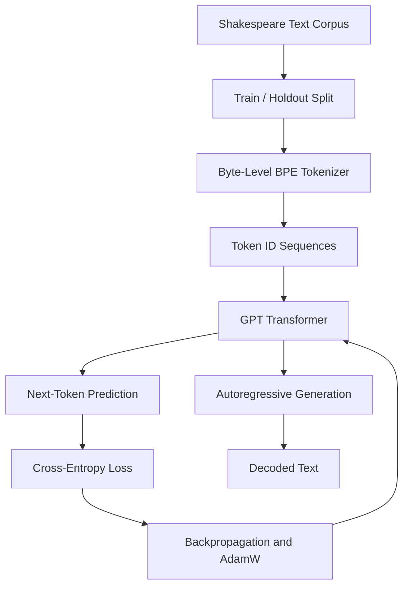

# Build a GPT from Scratch

### A tiny Transformer. Shakespearean text. A language model built from the ground up.

<p align="center">
  
  
  
  
  
</p>

<p align="center">
  <strong>Understanding language models by building one yourself.</strong>
  <br/>
  From byte-level tokenization and causal self-attention to training, sampling, and evaluation.
</p>

---

## 📌 Table of Contents

- [Overview](#-overview)
- [Project Highlights](#-project-highlights)
- [How It Works](#-how-it-works)
- [Model Architecture](#-model-architecture)
- [Project Structure](#-project-structure)
- [Getting Started](#-getting-started)
- [Training the Model](#-training-the-model)
- [Generating Text](#-generating-text)
- [Experiments and Evaluation](#-experiments-and-evaluation)
- [Sample Output](#-sample-output)
- [What I Learned](#-what-i-learned)
- [Limitations](#-limitations)
- [Reproducibility](#-reproducibility)
- [Acknowledgements](#-acknowledgements)

---

## 🌟 Overview

**Build a GPT from Scratch** is an educational deep-learning project focused on understanding the fundamental components of a GPT-style autoregressive language model.

Instead of relying on a pretrained language model, this project implements the core pipeline: tokenizing text, constructing a decoder-only Transformer, training it on a Shakespeare text corpus, and generating new text one token at a time.

The project explores both the engineering and experimental sides of language modeling, including model architecture, optimization, sampling strategies, validation loss, and inference performance.

The goal is not to compete with large production language models. It is to understand how the essential pieces fit together—and what happens when a small model learns to predict the next token.

> **The central idea:** A language model learns patterns in text by predicting what comes next. Repeating this process allows it to generate entirely new sequences.

## ✨ Project Highlights

| Component | What it does |
|---|---|
| Byte-level BPE | Learns a compact vocabulary by repeatedly merging frequent byte-token pairs. |
| GPT-style Transformer | Implements causal self-attention, residual connections, normalization, and feed-forward layers. |
| Next-token prediction | Trains the model to predict the next token in a sequence. |
| Training pipeline | Uses mini-batches, AdamW, learning-rate scheduling, gradient clipping, and validation. |
| Bigram baseline | Provides a simple reference model for comparing validation performance. |
| Text generation | Supports temperature, top-k, and top-p sampling. |
| KV caching | Reuses attention keys and values during autoregressive generation. |
| Controlled experiments | Compares model sizes and architectural or optimization changes. |
| Experiment tracking | Records training metrics, validation losses, and run configurations. |

## How It Works

The project follows a complete language-modeling pipeline:



1. **Tokenization:** Raw text is converted into integer token IDs.
2. **Training:** The model receives a sequence and learns to predict the next token at every position.
3. **Evaluation:** Validation loss measures how well the model predicts tokens it was not trained on.
4. **Generation:** The model repeatedly predicts and samples the next token to extend a prompt.
5. **Experimentation:** Different configurations are evaluated to investigate how architectural and optimization choices affect performance.

## Model Architecture

The model follows a decoder-only Transformer design inspired by GPT.

### Core components

**1. Token and positional embeddings**

Token IDs are mapped to learned vectors. Positional embeddings provide information about the order of tokens.

**2. Causal self-attention**

Each token can attend to earlier tokens and itself, but not future tokens. Query, key, and value projections are used to calculate attention.

**3. Pre-LayerNorm residual blocks**

Each Transformer block applies normalization, causal self-attention, a residual connection, and a feed-forward network with another residual connection.

**4. Feed-forward network**

A two-layer MLP expands the embedding dimension, applies GELU activation, and projects back to the original dimension.

**5. Language-modeling head**

The final normalized representations are projected to vocabulary-sized logits. The output projection shares its weights with the token embedding matrix.

### Model configurations

The assignment defines three principal configurations:

| Configuration | Transformer layers | Attention heads | Embedding dimension |
|---|---:|---:|---:|
| S — Small | 2 | 2 | 64 |
| M — Medium | 4 | 4 | 128 |
| L — Large | 6 | 6 | 192 |

The default context length is 128 tokens. Exact training settings are defined in the configuration files.

## 📁 Project Structure

```text
build-gpt/
├── tokenizer.py       # Byte-level BPE tokenizer
├── model.py           # GPT-style Transformer
├── train.py           # Training and validation pipeline
├── bigram.py          # Bigram baseline
├── generate.py        # Text generation and KV-cache benchmark
├── tokenizer.json     # Saved tokenizer vocabulary and merges
├── configs/           # Model and training configurations
├── logs/              # Training metric logs
├── runs.csv           # Experiment summary
├── samples.txt        # Generated text samples
├── git_log.txt        # Recorded Git history
├── report.pdf         # Assignment report
├── ai_disclosure.md   # AI assistance disclosure
├── requirements.txt   # Python dependencies
├── .gitignore         # Files excluded from Git
└── README.md          # Project documentation
```

*This tree describes the intended repository layout. Adjust it to match the files actually present in your repository.*

## Getting Started

### Prerequisites

- Python 3.10 or a compatible Python version
- PyTorch
- Git
- A terminal or Python development environment

A CPU is sufficient for basic testing and generation. Training speed will depend on the hardware and configuration.

### 1. Clone the repository

Replace the example username and repository name with your actual GitHub details.

```bash
git clone https://github.com/<your-github-username>/<your-repository>.git
cd <your-repository>
```

### 2. Create a virtual environment

```bash
python -m venv .venv
```

Activate it on Linux or macOS:

```bash
source .venv/bin/activate
```

On Windows PowerShell:

```powershell
.venv\Scripts\Activate.ps1
```

### 3. Install dependencies

```bash
python -m pip install --upgrade pip
pip install -r requirements.txt
```

Make sure `requirements.txt` lists the packages your implementation actually uses, including a compatible PyTorch version.

### 4. Inspect the available configurations

```bash
ls configs/
```

The project uses configuration files to specify model dimensions, batch size, learning rate, training duration, and other experiment settings.

## Training the Model

To train using the Medium configuration:

```bash
python train.py --config configs/M.json
```

The training pipeline is designed to:

- Create tokenized training and holdout sequences.
- Sample batches of consecutive tokens.
- Predict the next token at each sequence position.
- Calculate cross-entropy loss.
- Update model weights using AdamW.
- Apply learning-rate scheduling and gradient clipping.
- Evaluate performance periodically.
- Save the best model checkpoint.
- Record metrics for later analysis.

Training settings are controlled by the configuration files. Check the options supported by your implementation before launching a different run.

### Training metrics

The experiment logs track quantities such as:

| Metric | Meaning |
|---|---|
| `step` | Training iteration |
| `train_loss` | Cross-entropy loss on training batches |
| `val_loss` | Cross-entropy loss on holdout batches |
| `lr` | Learning rate at that step |
| `tokens_seen` | Approximate cumulative number of training tokens processed |

The experiment summary in `runs.csv` is intended to make comparisons across configurations easier.

## Generating Text

Once a compatible trained checkpoint and tokenizer are available, the generation script can produce new text.

For example, this command was used during development:

```bash
python generate.py \
  --run_id L \
  --temperature 0.8 \
  --max_new_tokens 120 \
  --seed 42
```

The script's available options and checkpoint-loading behavior depend on the implementation in the repository.

### Sampling strategies

| Strategy | Effect |
|---|---|
| Greedy decoding | Selects the highest-probability next token. |
| Temperature | Controls the sharpness of the sampling distribution. |
| Top-k sampling | Restricts sampling to the k most likely tokens. |
| Top-p sampling | Samples from the smallest high-probability token set whose cumulative probability reaches the chosen threshold. |
| KV caching | Reuses previous attention keys and values to avoid recomputing the entire prefix. |

A temperature of `0.8` introduces some variation while still favoring relatively likely tokens. Lower temperatures generally make outputs more predictable; higher temperatures generally increase variation.

### Example generation prompt

```text
ROMEO:
```

The model continues from the prompt using patterns learned from its training corpus.

Generated text is not retrieved from a database of complete Shakespeare passages. It is produced sequentially by predicting and sampling tokens.

## Experiments and Evaluation

A central part of this project is evaluating behavior rather than judging the model only by how its generated text looks.

### Model-size experiments

Configurations S, M, and L provide a way to investigate the effect of model capacity on validation loss and computational cost.

### Ablation experiments

The assignment also explores changes to selected design choices, such as:

- Removing positional embeddings.
- Changing from Pre-LayerNorm to Post-LayerNorm.
- Increasing the learning rate.
- Testing additional experimental modifications.

Each run should be documented using its configuration, training logs, and recorded validation results.

### Bigram baseline

The bigram model provides a simple statistical baseline. It predicts the next token using the preceding token and serves as a reference point for evaluating the GPT model.

**Assignment benchmark:** The best GPT validation loss is required to be no greater than 90% of the bigram baseline's validation loss.

The actual result should be verified using the values recorded by the completed experiments; it should not be assumed from successful text generation alone.

### KV-cache benchmark

During development, the generation script reported the following CPU benchmark:

| Measurement | Observed result |
|---|---:|
| Cached generation speed | 694.42 tokens/sec |
| Uncached generation speed | 388.30 tokens/sec |
| Reported speed-up | 1.79× |

These are observed results from one execution, not universal performance guarantees. Results can vary with hardware, workload, and runtime conditions.

The script also reported that cached and uncached greedy outputs matched. This is an important correctness check for the caching implementation.

### Experiment results

The canonical experiment results belong in [`runs.csv`](runs.csv), while detailed step-by-step metrics belong in [`logs/`](logs/).

> **Results policy:** Populate any published performance claims from actual recorded runs. Do not substitute illustrative values for measured results.

## Sample Output

A generated sample from development:

```text
ROMEO: but, if my say
Stand stay by the holy way and brain to his fast thee;
Seeming him in our honour that found by him,
Northumber-settle peace to thin him.

FRIAR LAURENCE:
Now plate is brow to this;
Who I fear thought to drawn her boy.

HATHASTINGS:
Sir Pruch God's grust
```

This sample demonstrates that the model can generate dialogue-like text and imitate aspects of Shakespearean formatting and vocabulary. It also illustrates a limitation: some word sequences are grammatically or semantically incoherent.

The sample is included as an example of model behavior, not as evidence that every evaluation requirement has passed.

For additional outputs, see [`samples.txt`](samples.txt).

## What I Learned

This project provides practical experience with several foundational ideas in modern language modeling:

- **Tokenization matters:** The vocabulary and merge rules determine how text is represented to the model.
- **Attention is causal:** A decoder-only language model must not access future tokens when predicting the next token.
- **Training is an optimization problem:** Loss curves help reveal learning progress, instability, and possible overfitting.
- **Baselines provide context:** A GPT's validation loss is more informative when compared against a simpler model.
- **Architecture and hyperparameters matter:** Model size, normalization, learning rate, and positional information can affect performance.
- **Generation is probabilistic:** Sampling settings change the balance between predictability and diversity.
- **Caching is an engineering trade-off:** KV caching can reduce repeated computation during autoregressive inference.
- **Evaluation requires evidence:** Successful execution and plausible text do not replace numerical tests and documented experiments.

## Limitations

This is a small, educational language model trained on a limited text corpus.

Consequently:

- Generated sentences may be incoherent or grammatically incorrect.
- Character names and dialogue formatting may be inconsistent.
- The model may repeat phrases or lose track of context.
- Generation quality depends on training, model configuration, and sampling settings.
- CPU performance differs from GPU performance.
- The model is not intended for factual question answering, general-purpose assistance, or production use.

These limitations are useful learning opportunities: they help illustrate the relationship between model capacity, training data, optimization, and language-generation quality.

## Created By 

**Priyanshu Sharma & Ayan Salmanova**

Built with curiosity, collaboration, and a love for AI.

<p align="center">
  <a href="https://www.linkedin.com/in/ayan-salmanova-b0b847359/">
    
  </a>
  &nbsp;
  <a href="https://www.linkedin.com/in/priyanshu-sharma-646233394/">
    
  </a>
</p>

<p align="center">
  <strong>Built from scratch. Trained one token at a time. </strong>
  <br/>
  <sub>A hands-on exploration of Transformers, language modeling, and the art of predicting what comes next.</sub>
</p>